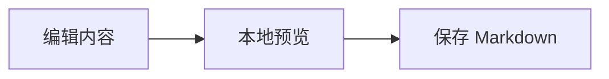

# 扩展内容

#### 标题四

##### 标题五



```html
<article style="padding:16px;border:1px solid #5a80c0;border-radius:8px">
  <h3>HTML 内容块</h3>
  <p>支持样式和静态内容。</p>
  <script>parent.document.body.dataset.rivetUnsafeHtml = 'executed';</script>
  
</article>
```

<section style="padding:12px"><h3>原始 HTML</h3><p>保存时保留 HTML 格式。</p></section>
